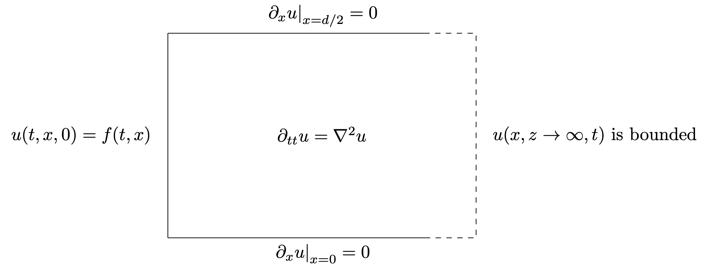

### pyTalbot

This project's aim is to plot the formation of the Talbot effect in the near field of an infinite periodic diffraction grating of Fourier coefficients $\hat{g}_n$. This corresponds to the numeric part of the paper *The Talbot Effect as a Causal Initial–Boundary-Value Problem: Formation, Stationary Limit and Paraxial Limit*. Its first version is the arXiv preprint [2507.00820](https://arxiv.org/abs/2507.00820), under the title *Deducing the Talbot Effect from Electrodynamics*. The section, equation and figure numbers below refer to the current version of the paper.

## Requirements

# With Docker
It is recommended to use [Docker](https://www.docker.com/) to install the dependencies and run the script. After having it installed, just create an image with the provided Dockerfile and run the script from the container. To compile the C libraries, run the following from the main folder,
```
cd pyTalbot/src
make
```


# Without Docker
In order to get all the python required libraries, you may run from the main folder
```
pip install -r requirements.txt
```

It is also necessary to compile the C libraries used for integration. For this you need GSL and OpenMPI. You may install them from the terminal in Ubundu and Debian through `sudo apt install gsl` and `sudo apt install openmpi`, and on macOS through `brew install gsl` and `brew install openmpi`.

To compile the libraries, run the following from the main folder,
```
cd pyTalbot/src
make
```

In order to be able to create the video, it is indispensable to have [FFmpeg](https://www.ffmpeg.org/) installed.

You may install it from the terminal in Ubundu and Debian through `sudo apt install ffmpeg` and on macOS through `brew install ffmpeg`.

## The problem

This project plots the solution to the 2D wave equation (Section 2 of the paper)

$$\partial_{tt} u = \partial_{xx} u + \partial_{zz} u$$

in the domain $0 < x < d/2$, $z > 0$, $t > 0$ under the border conditions in $x$

$$\left.\partial_x u\right\vert_{x=0} = \left.\partial_x u\right\vert_{x=d/2} = 0,$$

the boundary conditions in $z$

$$u(t,x,0) = f(t,x) = g(x)\sin(\omega t)\theta(t), \qquad \sup_{z\geq 0}\Vert u(t,\cdot,z)\Vert_{L^2(0,d)} \leq M e^{at},$$

and the initial conditions

$$u(t=0) = 0,\quad\text{and,}\quad \partial_t u(t=0) = 0.$$

We use units with $c = 1$, so that $\omega = 2\pi/\lambda$. For the grating we take, as in Section 5 of the paper, a slit of width $l$ centred at $x = 0$ which transmits light of amplitude $A d/l$, that is, $g(x) = A d/l$ for $\vert x\vert < l/2$ and $g(x) = 0$ for $l/2 < \vert x\vert \leq d/2$. Its Fourier coefficients are $\hat{g}_0 = A$ and $\hat{g}_n = A \frac{d}{l} \frac{\sin(n\pi l/d)}{n\pi}$, which tend to $A$ as $l \to 0$.

All of this can be sumarised through the figure


## The solution

The solution to this problem can be written in closed form (equation (3.5) of the paper): 

$$u(t,x,z) = \sum_{n\in\mathbb{Z}} \hat{g}_n\left( \sin\omega (t-z) - k_n z \int_z^{t} \dfrac{J_1\left( k_n\sqrt{\tau^2-z^2} \right)}{\sqrt{\tau^2-z^2}} \sin\omega(t-\tau) \,d\tau \right) \theta(t-z) \cos{k_n x},$$

where $k_n = 2\pi n/d$. This is what we plot. The RHS is mostly straightforward to compute, although certain approximations must be made:
  - The most obvious, we have to introduce an $N$ at which we truncate the series. As in the paper, we keep the terms with $\vert n\vert < N = 5\, \frac{d}{\lambda}$, which include all the propagating modes, $\vert k_n\vert \leq \omega$, and the first evanescent ones.
  - We have to numerically approximate the integral. In order to do this, we use GSL's adaptative quadrature method, [QAG](https://www.gnu.org/software/gsl/doc/html/integration.html#qag-adaptive-integration). In case that QAG runs into problems, we use [CQUAD](https://www.gnu.org/software/gsl/doc/html/integration.html#cquad-doubly-adaptive-integration), a doubly-adaptative method, instead.

After calculating $u(t,x,z)$ on a grid, we plot it and make an .mp4 video to showcase the transient behaviour of the Talbot effect.

There is also the possibility to plot the state of the field at the final time considering the stationary approximation, that is, the stationary field $U$ of equation (4.1), and to compare its result to the transient case. Section 4 of the paper shows that $u$ tends to $\mathrm{Im}[U e^{i\omega t}]$ as $t \to \infty$.

## Fast evaluation at a fixed time

For large $d/\lambda$ the adaptive quadrature becomes very expensive, since the integrand oscillates about $(k_n\sqrt{t^2-z^2} + \omega(t-z))/2\pi$ times for every mode and depth: between $2 \times 10^4$ and $2.4 \times 10^5$ times for the carpets with $d/\lambda = 100$ at $t = 2 z_T$. The module `pyTalbot/transient_fast.py` computes the same coefficients at a fixed time in a different way, explained in Appendix C of the paper. It splits off the stationary term and moves the path of the remaining integral into the complex plane, where the integrand decays exponentially and a few Gauss–Laguerre nodes suffice. For most diffraction orders, this reduces the number of evaluations of the integrand needed for a given accuracy by more than four orders of magnitude (Table 1 of the paper).

```python
import numpy as np
from pyTalbot.transient_fast import transient_mode

d_lambda = 100
omega, z_T = 2 * np.pi * d_lambda, 2. * d_lambda # Units with d = c = 1, and z_T = 2 d^2/λ
z = np.linspace(0, z_T, 2880)
c_50 = transient_mode(2 * np.pi * 50, 2 * z_T, z, omega) # c_n(t,z)/g_n for n = 50 at t = 2 z_T
```

The results are accurate to about $10^{-9}$ wherever $k_n\sqrt{t^2-z^2} \geq 100$. In the thin layer behind the wavefront where this fails, `transient_mode` warns; there one may integrate the defining formula directly, as `paper/transient_snapshots.py` does for Figure 2 of the paper, or use the adaptive integrator.

The folder `paper/` holds the scripts that reproduce the figures and the table of the paper (see `paper/README.md`), and `tests/test_transient_fast.py` checks the module against direct quadrature. You may run the tests with `python tests/test_transient_fast.py`, or with `pytest`.

## Running on a cluster

We are including a SLURM file for those interested in running the simulation on a cluster. Furthermore, the code is compatible with both OpenMP and MPI to speed up the computations when available.


## Aknowledgements

This project was developped by Gabriel María Ybarra Marcaida under the supervision of [Luis Vega González](https://www.bcamath.org/en/people/bcam-members/lvega) during the authour's research internship at the [Basque Centre for Applied Mathematics](https://www.bcamath.org/en) in between November 2024 and February 2025.

The authour would like to thank @miguelfrndz and @pcardenal5 with their help with programming issues throughout the development of the project.